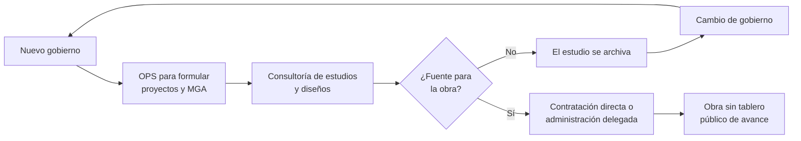

# 03 · El ciclo consultoría → MGA → OPS → nada: lo que dice SECOP

> **Qué es esto.** Un análisis de los contratos que la Alcaldía de Yondó, la E.S.E. Hospital Héctor Abad Gómez y Aguas y Aseo de Yondó publicaron en SECOP I y II entre 2007 y octubre de 2026. Son datos públicos y descargables; el código para reproducir todo está en `scripts/`.
>
> **Qué no es.** No es una acusación contra ninguna persona. Los patrones que aparecen aquí son *indicios* que deben cerrarse con los expedientes contractuales, las actas de recibo y visitas de campo. Las personas naturales contratistas no se nombran.

## 1. Fuente y método

| Paso | Detalle |
|---|---|
| Fuente | SECOP Integrado, datos.gov.co, conjunto `rpmr-utcd` (une SECOP I y SECOP II). Filtro: municipio de la entidad = Yondó o nombre de la entidad contiene "YONDÓ". Descarga: 20-oct-2026. |
| Registros brutos | 14.301 |
| Excluidos | 2.881 procesos sin fecha de firma (convocados, borradores, cancelados); 46 sin valor; duplicados de SECOP I por contratista y versiones repetidas de SECOP II (se conserva el mayor valor); un registro de 2011 por $1,25 billones que es un error de digitación evidente. |
| Contratos depurados | 10.279 |
| Clasificación | Por tipo de contrato, modalidad y palabras del objeto. Ver `scripts/secop_analisis.py`, función `cat()`. Las transferencias a entidades públicas (empresa de servicios públicos, Aguas y Aseo, E.S.E., EDU) cuentan como convenios. |
| Valores | Pesos corrientes de cada año, sin deflactar. |
| Cobertura | **2004–2007 no es comparable**: solo hay 41 contratos de 2007 en SECOP. La publicación sistemática empieza en 2008–2011. El hospital no publicó contratos de 2008–2011 ni de 2016–2019; su cobertura es parcial en todos los periodos. |

Para reproducir:

```bash
scripts/descargar_secop.sh data/secop/raw
python3 scripts/secop_analisis.py data/secop/raw && mv data/secop/raw/secop_resumen.json data/secop/
python3 scripts/tablas_secop_md.py   # regenera las tablas de este documento
```

## 2. Los cinco hallazgos

### 2.1 La competencia desapareció después de 2020

En 2016–2019, el 31 % del valor contratado por la alcaldía se adjudicó sin pluralidad de oferentes. En 2020–2023 fue el 82 % y en lo corrido de 2024–2026, el 83 %. La contratación directa, los convenios con fundaciones y asociaciones (Decreto 092 de 2017) y la administración delegada con otras entidades públicas reemplazaron a la licitación.

La consecuencia práctica es que el precio no se forma por competencia y que la selección del ejecutor real (el subcontratista de la entidad delegada) queda fuera del control del Concejo y de la veeduría local.

### 2.2 La obra pública se trasladó a la EDU de Medellín

La obra contratada directamente por la alcaldía cayó de $70.875 millones en 2016–2019 a $21.316 millones en 2020–2023 y $5.550 millones en 2024–2026. Al mismo tiempo, los convenios e interadministrativos subieron de $14.038 a $127.419 millones. La explicación está en cinco contratos con la **Empresa de Desarrollo Urbano de Medellín (EDU)** por **$84.016 millones** (ver tabla al final), entre ellos uno de $50.566 millones (septiembre de 2021) para urbanismo, vías y escenarios deportivos y otro de $15.820 millones (mayo de 2023) para vivienda nueva.

La administración delegada es legal, pero tiene tres costos: la entidad delegada cobra un porcentaje de administración, la selección de los constructores no la ve el municipio, y el seguimiento técnico depende de la información que la delegada quiera entregar. Lo que hay que verificar, contrato por contrato: actas de recibo, obras entregadas frente a las prometidas, porcentaje de administración cobrado y rendimientos financieros devueltos.

### 2.3 Miles de OPS, pocas plantas de personal

Desde 2012 la alcaldía firma entre 250 y 690 contratos de prestación de servicios y apoyo a la gestión por año, con 170 a 500 personas distintas. Entre 2008 y 2026 suman 5.580 contratos. Parte de ese volumen cubre funciones permanentes (atención al público, archivo, apoyo a secretarías) que, por jurisprudencia de la Corte Constitucional (C-614 de 2009, C-171 de 2012), deberían estar en planta. Otra parte se dedica a "apoyar la formulación de proyectos".

### 2.4 Formular proyectos se paga por meses, no por resultados

Se identificaron 425 OPS de la alcaldía cuyo objeto es apoyar la planeación, la formulación de proyectos, el banco de proyectos o la Secretaría de Planeación, por **$10.550 millones**. El crecimiento es continuo: 7 contratos en 2008–2011, 53 en 2012–2015, 125 en 2016–2019, 172 en 2020–2023 y 68 en lo corrido de 2024–2026. De los 125 objetos que mencionan expresamente formulación, MGA, banco de proyectos o estructuración, ninguno exige radicar o viabilizar un proyecto: 24 mencionan regalías y 2 el OCAD, pero como ámbito de apoyo, no como producto entregable. Se pagan por tiempo de servicio.

### 2.5 De cada diez estudios, dos llegan a obra

La alcaldía contrató **124 estudios, diseños y consultorías por $24.409 millones** entre 2008 y 2026. Solo en **27 (22 %)** aparece después en SECOP una obra con objeto relacionado, y solo **14 (11 %)** de esas obras figuran liquidadas o terminadas. Los casos de mayor valor sin obra posterior identificable incluyen:

- Diseños arquitectónicos y técnicos más obras de urbanismo con la EDU (2021, $11.696 millones).
- Estudios y diseños fase III de la vía La Ye–Yondó con la EDU (2021, $1.623 millones).
- Estudios, diseños y rediseño de los acueductos rurales (2013, $1.159 millones).
- Revisión general del Esquema de Ordenamiento Territorial (2019, $842 millones).
- Estudios y diseños de líneas de alcantarillado y agua potable (2012, $834 millones y $600 millones).
- Estudios y diseños de la Ciudadela Educativa (2014, $300 millones).

**Advertencia de método.** La coincidencia estudio → obra se calcula por palabras clave del objeto (similitud de Jaccard ≥ 0,30). Una obra puede haberla ejecutado otra entidad (Gobernación, Ecopetrol, Findeter, la propia EDU) y no figurar como contrato de la alcaldía. Por eso esta lista es una agenda de verificación, no una conclusión.

## 3. Cómo funciona el ciclo



Los cuatro puntos de ruptura:

1. **El estudio se contrata antes de saber quién paga la obra.** Sin fuente identificada, el diseño envejece (precios, normas, predios) y el siguiente gobierno lo vuelve a contratar.
2. **La formulación es nómina.** Las OPS de formulación no responden por un producto. El indicador real debería ser "proyectos radicados en el SUIFP-SGR / PMIDS / convocatoria, y cuántos se viabilizaron".
3. **No hay banco de proyectos vivo y público.** Los estudios no quedan publicados con planos y presupuesto; el empalme no transfiere el inventario.
4. **La ejecución sale del control local.** Cuando la obra se delega, el municipio pierde la trazabilidad que da una licitación con pliegos tipo.

## 4. Qué hacer con estos datos (agenda de verificación)

| # | Pregunta | Dónde se responde |
|---|---|---|
| 1 | ¿Qué obras entregó la EDU en cada uno de los 5 contratos, cuánto cobró de administración y qué rendimientos devolvió? | Expedientes SECOP II, actas de liquidación, informe de la Contraloría General de Antioquia |
| 2 | ¿Cuáles de los 124 estudios siguen vigentes y se pueden actualizar en vez de recontratar? | Archivo de Planeación + inventario público (hito de diciembre de 2026 en la hoja de ruta) |
| 3 | ¿Cuántos proyectos radicaron los 425 contratistas de formulación y cuántos se financiaron? | SUIFP-SGR, Banco de Proyectos Municipal, informes de supervisión de cada OPS |
| 4 | ¿Qué funciones permanentes se cubren con OPS año tras año? | Manual de funciones vs. objetos de OPS repetidos |
| 5 | ¿Por qué el hospital no publicó contratos en 2016–2019? | Requerimiento a la E.S.E. y a la Contraloría (SIA Observa) |

## 5. Tablas completas


**Alcaldía — valor contratado (millones COP corrientes)**

| Categoría | 2008-2011 | 2012-2015 | 2016-2019 | 2020-2023 | 2024-2027 |
|---|---:|---:|---:|---:|---:|
| Obra | 52.083 | 43.212 | 70.875 | 21.316 | 5.550 |
| OPS / apoyo a la gestión | 6.268 | 37.297 | 28.871 | 22.261 | 16.091 |
| Convenios / interadministrativos | 26.066 | 19.909 | 14.038 | 127.419 | 50.971 |
| Estudios / consultoría | 2.622 | 4.896 | 3.225 | 14.369 | 457 |
| Interventoría | 3.790 | 3.540 | 4.569 | 616 | 233 |
| Suministro / compraventa | 9.354 | 10.898 | 12.270 | 9.131 | 1.442 |
| Otros servicios | 31.253 | 12.522 | 11.034 | 12.603 | 12.756 |
| **Total** | **131.435** | **132.274** | **144.881** | **207.715** | **87.500** |

**Alcaldía — número de contratos**

| Categoría | 2008-2011 | 2012-2015 | 2016-2019 | 2020-2023 | 2024-2027 |
|---|---:|---:|---:|---:|---:|
| Obra | 74 | 165 | 106 | 30 | 15 |
| OPS / apoyo a la gestión | 91 | 1.862 | 1.501 | 1.251 | 875 |
| Convenios / interadministrativos | 46 | 93 | 105 | 127 | 62 |
| Estudios / consultoría | 27 | 25 | 26 | 24 | 23 |
| Interventoría | 49 | 42 | 35 | 5 | 1 |
| Suministro / compraventa | 57 | 100 | 147 | 80 | 34 |
| Otros servicios | 180 | 99 | 70 | 111 | 222 |
| **Total** | **524** | **2.386** | **1.990** | **1.628** | **1.232** |

**E.S.E. Hospital Héctor Abad Gómez — valor contratado (millones COP corrientes)**

| Categoría | 2008-2011 | 2012-2015 | 2016-2019 | 2020-2023 | 2024-2027 |
|---|---:|---:|---:|---:|---:|
| Obra | 0 | 13 | 0 | 26 | 183 |
| OPS / apoyo a la gestión | 0 | 666 | 0 | 3.109 | 2.415 |
| Convenios / interadministrativos | 0 | 79 | 0 | 87 | 69 |
| Estudios / consultoría | 0 | 0 | 0 | 2 | 0 |
| Interventoría | 0 | 0 | 0 | 0 | 0 |
| Suministro / compraventa | 0 | 560 | 0 | 481 | 75 |
| Otros servicios | 0 | 40 | 0 | 589 | 649 |
| **Total** | **0** | **1.357** | **0** | **4.293** | **3.391** |

**E.S.E. Hospital Héctor Abad Gómez — número de contratos**

| Categoría | 2008-2011 | 2012-2015 | 2016-2019 | 2020-2023 | 2024-2027 |
|---|---:|---:|---:|---:|---:|
| Obra | 0 | 1 | 0 | 1 | 1 |
| OPS / apoyo a la gestión | 0 | 128 | 0 | 213 | 151 |
| Convenios / interadministrativos | 0 | 10 | 0 | 8 | 6 |
| Estudios / consultoría | 0 | 0 | 0 | 1 | 0 |
| Interventoría | 0 | 0 | 0 | 0 | 0 |
| Suministro / compraventa | 0 | 15 | 0 | 15 | 4 |
| Otros servicios | 0 | 4 | 0 | 27 | 17 |
| **Total** | **0** | **158** | **0** | **265** | **179** |

**Aguas y Aseo de Yondó — valor contratado (millones COP corrientes)**

| Categoría | 2008-2011 | 2012-2015 | 2016-2019 | 2020-2023 | 2024-2027 |
|---|---:|---:|---:|---:|---:|
| Obra | 29 | 11.556 | 8.875 | 21.549 | 746 |
| OPS / apoyo a la gestión | 0 | 1.753 | 3.404 | 1.082 | 126 |
| Convenios / interadministrativos | 0 | 31 | 115 | 21 | 26 |
| Estudios / consultoría | 0 | 413 | 1.701 | 477 | 0 |
| Interventoría | 0 | 578 | 766 | 1.370 | 0 |
| Suministro / compraventa | 0 | 2.241 | 4.120 | 2.649 | 54 |
| Otros servicios | 0 | 367 | 1.853 | 804 | 0 |
| **Total** | **29** | **16.940** | **20.833** | **27.950** | **953** |

**Aguas y Aseo de Yondó — número de contratos**

| Categoría | 2008-2011 | 2012-2015 | 2016-2019 | 2020-2023 | 2024-2027 |
|---|---:|---:|---:|---:|---:|
| Obra | 1 | 34 | 17 | 15 | 2 |
| OPS / apoyo a la gestión | 0 | 314 | 797 | 74 | 4 |
| Convenios / interadministrativos | 0 | 4 | 3 | 3 | 3 |
| Estudios / consultoría | 0 | 20 | 20 | 11 | 0 |
| Interventoría | 0 | 7 | 9 | 6 | 0 |
| Suministro / compraventa | 0 | 68 | 126 | 76 | 1 |
| Otros servicios | 0 | 23 | 68 | 28 | 0 |
| **Total** | **1** | **470** | **1.040** | **213** | **10** |

**Alcaldía — modalidad sin competencia (directa, convenios, régimen especial)**

| Periodo | Contratos | Valor (M COP) | % del valor | % de los contratos |
|---|---:|---:|---:|---:|
| 2004-2007 | 41 | 4.960 | 55.2 % | 87.8 % |
| 2008-2011 | 524 | 131.435 | 54.2 % | 69.5 % |
| 2012-2015 | 2.386 | 132.274 | 54.9 % | 89.4 % |
| 2016-2019 | 1.990 | 144.881 | 30.9 % | 80.5 % |
| 2020-2023 | 1.628 | 207.715 | 82.4 % | 89.8 % |
| 2024-2027 | 1.232 | 87.500 | 83.4 % | 91.6 % |

**Alcaldía — OPS y apoyo a la gestión por año**

| Año | Contratos | Personas/empresas distintas | Valor (M COP) |
|---|---:|---:|---:|
| 2008 | 1 | 1 | 50 |
| 2009 | 13 | 11 | 351 |
| 2010 | 24 | 24 | 1.134 |
| 2011 | 53 | 51 | 4.733 |
| 2012 | 568 | 500 | 5.093 |
| 2013 | 694 | 503 | 13.361 |
| 2014 | 305 | 230 | 6.901 |
| 2015 | 295 | 210 | 11.943 |
| 2016 | 321 | 201 | 9.919 |
| 2017 | 307 | 189 | 6.135 |
| 2018 | 486 | 326 | 5.926 |
| 2019 | 387 | 247 | 6.892 |
| 2020 | 292 | 209 | 4.495 |
| 2021 | 340 | 222 | 4.230 |
| 2022 | 330 | 243 | 7.335 |
| 2023 | 289 | 262 | 6.200 |
| 2024 | 359 | 246 | 6.130 |
| 2025 | 259 | 174 | 4.428 |
| 2026 | 257 | 185 | 5.533 |

**OPS cuyo objeto es planeación, formulación o banco de proyectos**

| Entidad | Periodo | Contratos | Valor (M COP) |
|---|---|---:|---:|
| AGUAS | 2016-2019 | 3 | 18 |
| AGUAS | 2020-2023 | 9 | 51 |
| ALCALDIA | 2008-2011 | 7 | 175 |
| ALCALDIA | 2012-2015 | 53 | 852 |
| ALCALDIA | 2016-2019 | 125 | 1.880 |
| ALCALDIA | 2020-2023 | 172 | 4.417 |
| ALCALDIA | 2024-2027 | 68 | 3.225 |
| HOSPITAL | 2012-2015 | 2 | 20 |
| HOSPITAL | 2024-2027 | 2 | 16 |

**Contratos con la Empresa de Desarrollo Urbano de Medellín (EDU)**

| Fecha | Valor (M COP) | Objeto |
|---|---:|---|
| 2021-05-20 | 1.623 | Contrato interadministrativo de consultoria para la ejecucion de estudios y disenos fase lll destinados a la intervencion de la via la ye- yondo codigo 62n29-1 en el departamento de antioquia. |
| 2021-09-03 | 50.566 | Contrato interadministrativo de  administraciòn delegada para la adecuaciòn mantenimiento y construcciòn de urbanismo vìas y escenarios deportivos en el municipio de yondò- departamento de antioquia a |
| 2021-11-11 | 11.696 | Contrato interadministrativo de administraciòn delegada para diseños arquitectonicos y tècnicos asì como la adecuaciòn mantenimiento y construcciòn de urbanismo vìas y escenarios deportivos en el muni |
| 2023-05-23 | 15.820 | Contrato interadministrativo de administracion delegada para obras para la ejecucion de los proyectos con bpin 2022003050034 cuyo nombre es construccion de vivienda nueva rural en sitio propio en el m |
| 2023-06-26 | 4.312 | Contrato interadministrativo de administracion delegada para la adecuacion mantenimiento y construccion de vias urbanismo y espacios publicos en el municipio de yondo -departamento de antioquia. |

**Estudios y consultorías (alcaldía): 124 contratos, 24.409 M COP; con obra posterior identificable: 27**

| Año | Valor (M COP) | Objeto | Obra posterior identificable en SECOP |
|---|---:|---|---|
| 2021 | 11.696 | Contrato interadministrativo de administraciòn delegada para diseños arquitectonicos y tècnicos asì como la adecuaciòn mantenimiento y construcciòn de | No hallada |
| 2021 | 1.623 | Contrato interadministrativo de consultoria para la ejecucion de estudios y disenos fase lll destinados a la intervencion de la via la ye- yondo codig | No hallada |
| 2013 | 1.159 | Aunar esfuerzos  en la realizacion de estudios y disenos y rediseno de los acueductos rurales del municipio de yondo | No hallada |
| 2009 | 1.000 | Apoyo para el diseno y construccion del sistema de recoleccion de agua lluvias reparacion de unidades sanitarias de docentes y preescolar reparacion d | Sí (2010, Celebrado): Construccion de bodega adecuacion y reparacion de la zona administrativa techos cielo raso |
| 2019 | 842 | Prestacion de servicios para la revision general del esquema de ordenamiento territorial- eot del municipio de yondo antioquiacon el objetivo de adapt | No hallada |
| 2012 | 834 | Aunar esfuerzoz para elaborar estudios y disenos  interventorias y construcciones de obras de lineas de alcantarillado   de agua potable zona urbana y | No hallada |
| 2019 | 716 | Inteventoria  tecnica financiera y administrativa de la obra publica  para el mejoramiento de vias terciairas mediante la construccion de placa huella | Sí (2019, Liquidado): Mejoramiento de vias terciarias mediante la construccion de placa huellas en las vereda ca |
| 2012 | 600 | Convenio para los estudiosdisenos de lineas de alcantarilado y agua potable construccion de las obras de garanticen en la entrega en su parte final de | No hallada |
| 2018 | 331 | Prestacion de servicios de acompanamiento y seguimiento tecnico para la ejecucion de los siguientes proyectos: 2017-05893-0003/ apoyo tecnologico para | No hallada |
| 2014 | 300 | Consultoria para la elaboracion de estudios y disenos de la ciudadela educativa del municipio de yondo | No hallada |
| 2020 | 300 | Contrato interadministrativo entre el municipio de yondo y la asociacion de municipios del magdalena medio antioqueno- estudios y disenos para la impl | No hallada |
| 2022 | 224 | Realizar estudios y disenos para la dotacion de servicios el predio urbano localizado en el barrio jose domingo oliveros con el fin de desarrollar pro | No hallada |
| 2008 | 200 | Apoyo insterinstitucional y financiero para el estudip. diseno y diagnostico del acueducto del municipio de yondo antioquia. | No hallada |
| 2014 | 183 | Aunar esfuerzos para realizar estudios disenos y limpieza de las redes de alcantarillado | No hallada |
| 2019 | 160 | Consultoria para la elaboracion de los estudios y disenos para la primera fase de ejecucion del proyecto implementacion del sistema de acopio agricola | No hallada |
| 2013 | 150 | Aunar esfuerzos que permitan la revision y ajuste del esquema de ordenamiento territorial  en metas de largo plazo | No hallada |
| 2016 | 145 | Consultoria para la elaboracion de los estudios y disenos para evaluacion de alternativas de mejoramiento de subrasante de la via  rural entre  la ye  | No hallada |
| 2010 | 140 | Consultoria para la formulacion del plan parcial  en un area aproximada de 10 has en suelo de expansion urbana | No hallada |
| 2018 | 140 | Aunar esfuerzos para la realizacion de un estudio tecnico de revision   inspeccionm pruebas viabilizacion y certificacion de las redes de gas natural  | No hallada |
| 2010 | 140 | Consultoria para estudios y disenos de los sistemas de  bombeo y tratamiento de aguas residuales para el casco urbano | No hallada |
| 2009 | 128 | Apoyo para la formulacion del plan turistico formacion y seguridad para el desarrollo turistico del municipio de yondo antioquia | No hallada |
| 2018 | 117 | Aunar esfuerzos para la ejecucion de la consultoria para la elaboracion de los estudios y disenos para la pavimentacion de las vias urbanas -corregimi | No hallada |
| 2009 | 110 | Consultoria para los estudios tecnicos y disenos para la construccion ampliacion y mejoramiento de establecimiento educativos. | No hallada |
| 2011 | 100 | Consultoria para estudios  y disenos para la remodelacion de la institucion educativa san miguel del tigre en el municipio de yondo | Sí (2013, Liquidado): Obra publica para el mejoramiento de la institucion educativa san miguel del tigre |
| 2016 | 100 | Aunar esfuerzos para la realizacion de los estudios y disenos para las redes de gas natural externa e internas residenciales de las  veredas kilometro | No hallada |
