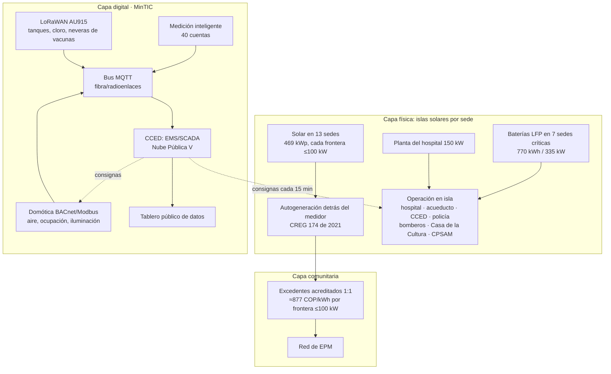

# 05 · Proyecto 1: Red Energética Pública de Yondó (REPY)

**Islas solares resilientes en las sedes públicas, comunidad energética de cuentas oficiales y capa domótica/IoT con un Centro de Control Energético y Digital (CCED) apoyado por MinTIC.**

> Estado: **prefactibilidad**. Los consumos por sede son supuestos por tipología o análogos verificados, marcados en `data/microrred.json`. La fase 0 de la hoja de ruta los reemplaza por 12 facturas EPM de cada cuenta (NIU) antes de contratar. Los precios unitarios están en `data/presupuesto_microrred.json` con su fuente y nivel de certeza. La simulación hora a hora está en la vista **Microrred** del atlas y se verifica con `node scripts/verificar_sim.mjs`. La evidencia completa (tarifas, normas, costos, casos FENOGE) está en `docs/anexos/D-energia-mintic.md`.

## 1. Por qué Yondó necesita esto

| Hecho | Dato | Fuente |
|---|---|---|
| Yondó depende de **un solo punto de suministro** | Subestación Yondó de EPM (10 MVA, 34,5/13,2 kV), alimentada por dos circuitos de 34,5 kV desde la subestación Barranca, en Santander. En operación desde 2021 ($15.509 M) | EPM, 2020–2021 |
| Las cuentas oficiales pagan **tarifa plena** | Oficial NT1: **991,29 COP/kWh**; acueducto (ESPD): **1.090,41 COP/kWh** (octubre de 2026) | Tarifas EPM, oct-2026 |
| El sol es **abundante y estable** | 5,08–5,51 kWh/m²·día; 1.602 kWh/kWp·año de referencia; mínimo mensual en noviembre (4,56) | NASA POWER; Global Solar Atlas |
| Hay un **caso vecino que funcionó** | Hospital de Simití (misma subregión PDET): 230 kWp, cubre el 100 % del consumo, $3.152 M, financiado por FENOGE (2025) | FENOGE |
| El municipio **no aprovechó la convocatoria** que encaja | Yondó está entre los 209 beneficiarios del Incentivo a la Producción del SGR. La línea "Territorios energéticos" (hasta $8.000 M y dos proyectos) financia solar en hospitales, acueductos, colegios y centros administrativos. Yondó presentó solo un proyecto rural, que no cumplió | MinEnergía, Convocatoria IP 2025 |
| La conectividad es mínima | 3,56 accesos fijos de internet por 100 habitantes (2025), frente a 26,1 en Antioquia | MinTIC vía TerriData |
| Ecopetrol ya genera solar **en Yondó** | Granja La Iguana: 26 MWp, 42,2 GWh/año, inaugurada en diciembre de 2025, para la refinería y los campos Casabe y Llanito | Ecopetrol |

## 2. Arquitectura en tres capas

**Decisión de diseño clave.** Cada sede es un autogenerador de **hasta 100 kW**: así se conecta sin estudio de conexión y su excedente vale unos 877 COP/kWh. Por encima de 100 kW vale unos 404 COP/kWh y exige contrato de respaldo (CREG 174 de 2021, modificada por la CREG 101 072 de 2025). Por eso el hospital se limita a 100 kWp y el acueducto se divide en dos fronteras de 75 kWp.

**Microrred física, fase posterior.** Unir hospital, alcaldía y policía en un mismo alimentador de 13,2 kV con un punto de acople común exige acuerdo con EPM, dueña de la red. No se recomienda en la primera fase. La resiliencia se logra con **islas por sede coordinadas por el EMS**.

### 2.1 Sedes y dimensionamiento

| Sede | Consumo supuesto (kWh/mes) | Solar (kWp) | Baterías | Prioridad en falla |
|---|---:|---:|---|:---:|
| E.S.E. Hospital Héctor Abad Gómez | 25.000 (análogo Simití) | 100 (60 cubierta + 40 marquesina) | 400 kWh / 150 kW | P1 |
| Acueducto: captación, PTAP y EBAR (2 fronteras) | 30.000 | 150 (piso) | 150 kWh / 75 kW | P1 |
| Centro de datos del CCED | 2.200 | — | (con la alcaldía) | P1 |
| Palacio Municipal | 8.000 | 50 | 120 kWh / 60 kW | P2 |
| Estación de Policía | 3.000 | 15 | 30 kWh / 15 kW | P1 |
| Cuerpo de Bomberos | 1.500 | 10 | 20 kWh / 10 kW | P1 |
| Casa de la Cultura y Biblioteca (refugio) | 2.000 | 12 | 20 kWh / 10 kW | P2 |
| CPSAM y Centro Vida Cañitas Sabias | 3.200 | 20 | 30 kWh / 15 kW | P2 |
| I.E. Luis Eduardo Díaz (principal) | 4.000 | 30 | — | P3 |
| I.E. Luis Eduardo Díaz (primaria) | 4.000 | 25 | — | P3 |
| Parque Educativo | 2.000 | 12 | — | P3 |
| Coliseo Benito Arias | 2.400 | 45 | — | P3 |
| Alumbrado público (≈1.000 LED, inventario por verificar) | 21.600 | — | — | P3 |
| **Total** | **108.900** | **469** | **770 kWh / 335 kW** | |

Parámetros (todos en `data/microrred.json`): rendimiento de diseño 3,69 kWh/kWp·día (Global Solar Atlas × 0,84 por pérdidas de techo plano, temperatura y polvo), eficiencia de baterías del 90 %, reserva del 35 % en operación normal y precarga al 90 % cuando hay alerta de falla.

### 2.2 Capa digital (componente MinTIC)

| Componente | Función | Estándar |
|---|---|---|
| Medición inteligente (AMI) | Consumo y generación cada 15 minutos por cuenta | Clase 0,5S; Modbus/DLMS |
| Domótica | Aires a 24 °C con sensores de ocupación; iluminación | BACnet o Modbus hacia pasarela; MQTT al CCED |
| Sensores IoT | Niveles de tanques, presión, cloro, temperatura de neveras de vacunas | LoRaWAN AU915 (banda libre 915–928 MHz) |
| CCED | EMS/SCADA, historiador, tablero ciudadano | IEC 61850 / IEEE 2030.7 en el control de isla; datos abiertos |
| Hospedaje | EMS y plataforma IoT | Acuerdo marco Nube Pública V (vigente hasta marzo de 2028) |
| Ciberseguridad | Segmentación OT/IT, doble factor, copias | IEC 62443; MSPI de Gobierno Digital |

La guía FUTIC de MinTIC para Ciudades y Territorios Inteligentes cofinancia dispositivos IoT, servicios en la nube, equipo de trabajo, capacitación e ingeniería de detalle. **No cofinancia plataformas propias**: por eso el EMS se contrata como servicio. El reto "territorios inteligentes" de Máxima Velocidad 2026 sirve para el acompañamiento técnico.

## 3. Cómo opera minuto a minuto

El EMS decide cada 15 minutos (`web/js/sim.js` implementa la misma lógica):

1. **Mide** generación solar y demanda de cada sede.
2. **Si sobra sol**: carga baterías hasta el 95 %; el resto se exporta y se acredita 1:1.
3. **Si falta**: descarga baterías hasta la reserva del 35 %; el resto se compra a EPM.
4. **Respuesta de la demanda**: el bombeo del acueducto se concentra entre las 8:00 y las 16:00, usando los tanques como batería hidráulica.
5. **Domótica**: aires a 24 °C, ocupación e iluminación (ahorro supuesto de 8 a 25 % según la sede); alumbrado atenuado de madrugada.
6. **Falla de red**: las siete sedes críticas se aíslan. Atienden primero P1 (hospital, acueducto, CCED, policía, bomberos); P2 si la batería supera el 45 %; P3 se desconecta. La planta del hospital arranca solo cuando la batería baja del 8 %.

### Resultados de la simulación (día típico)

| Escenario | Solar (kWh/día) | Compra a EPM (kWh/día) | Autosuficiencia | Cargas críticas atendidas |
|---|---:|---:|---:|---:|
| Hoy, sin solar ni gestión | 0 | 3.630 | 0 % | 100 % (con red) |
| Solar + baterías + bombeo diurno + domótica | 1.731 | 1.556 | 52 % | 100 % |
| Igual, día muy nublado (80 %) | 964 | 2.305 | 29 % | 100 % |
| Falla de red de 24 h, día normal | 1.317 | 0 | 61 % de la demanda atendida | 100 %, con 99 kWh de planta |
| Falla de red de 24 h, día muy nublado | 734 | 0 | 58 % de la demanda atendida | 100 %, con 571 kWh de planta |

En un día normal, las cuentas oficiales compran un **57 % menos** de energía que hoy. En una falla de 24 horas, el hospital, el acueducto y la fuerza pública siguen funcionando, y la planta diésel trabaja una fracción del tiempo.

## 4. Presupuesto (COP constantes 2026, prefactibilidad −30 % / +50 %)

| Bloque | Valor |
|---|---:|
| Generación solar (469 kWp: cubiertas, marquesina, piso) | $1.657 M |
| Baterías LFP con inversor híbrido (770 kWh, 7 sedes) | $1.078 M |
| Transferencias automáticas y tableros críticos (7 sedes) | $245 M |
| Capa digital MinTIC: EMS, CCED, AMI, LoRaWAN, sensores, domótica, telegestión piloto, conectividad | $1.774 M |
| Eficiencia: aires inverter, LED, variadores en bombas | $400 M |
| Obras eléctricas, cubiertas y dictamen RETIE | $300 M |
| Componente rural: 10 sedes y Centros Digitales de San Miguel del Tigre | $600 M |
| **Costo directo** | **$6.054 M** |
| Indirectos: ingeniería de detalle 3 %, interventoría 7 %, O&M 3 años 4 %, imprevistos 5 % | $1.150 M |
| **Inversión total** | **≈ $7.204 M (≈ USD 2,3 M)** |

> **Cambio del 22-oct-2026.** El nodo del hospital (100 kWp, 400 kWh, tablero y BMS; $1.155 M de costo directo) pasa a la torre de servicios de primer nivel (proyecto P7 de `docs/11`), porque el edificio actual deja de ser asistencial. Sin él, este proyecto queda en $5.829 M (`docs/07`, nota 1). Las cifras de energía de la microrred no cambian: el nodo sigue siendo el mismo, solo cambia el edificio donde se instala.
| Ahorro anual en facturas (simulación × 365) | ≈ $771 M |
| Retorno simple del proyecto completo | ≈ 9,3 años |
| Retorno simple del núcleo solar + baterías ($2.735 M) | ≈ 3,5 años |

El componente digital, rural y de eficiencia se justifica por resiliencia, servicio y cofinanciación, no solo por la factura. El cálculo no incluye inflación tarifaria, degradación de paneles (≈0,5 %/año) ni reposición de baterías (año 10–12).

### Fases

| Fase | Alcance | Valor |
|---|---|---:|
| A · 2027–2028 | Hospital + acueducto + CCED + capa digital base | ≈ $3.962 M |
| B · 2029 | Alcaldía, policía, bomberos, Casa de la Cultura, CPSAM, colegios, coliseo | ≈ $2.161 M |
| C · 2030 | Rural, telegestión de alumbrado y ajustes | ≈ $1.081 M |

### Mezcla de financiación propuesta

| Fuente | % | Valor |
|---|---:|---:|
| SGR · Incentivo a la Producción, línea "Territorios energéticos" (hasta $8.000 M, 2 proyectos) | 35 % | $2.521 M |
| Obras por Impuestos (Yondó es PDET/ZOMAC; Ecopetrol es el mayor contribuyente del mecanismo) | 20 % | $1.441 M |
| FENOGE · ConEnergía (focaliza municipios PDET) | 15 % | $1.081 M |
| PMIDS de Antioquia / MinSalud (componente hospital) | 10 % | $720 M |
| MinTIC · FUTIC (IoT, nube, capacitación) | 8 % | $576 M |
| Recursos propios: municipio, E.S.E., Aguas y Aseo | 7 % | $504 M |
| Crédito Findeter "Municipios Territorios Energéticos" (IBR + 0,7 %, 10 años) | 5 % | $360 M |

No hay acuerdo marco de Colombia Compra Eficiente vigente para solar (el último cerró en octubre de 2025): la compra va por **licitación con pliegos tipo** o ejecución directa de FENOGE. La alcaldía no declara renta, así que no aprovecha la deducción del 50 % de la Ley 1715, pero sí la exclusión de IVA y la exención de arancel con certificado UPME.

## 5. Normas que habilitan el proyecto

| Norma | Qué permite |
|---|---|
| Ley 1715 de 2014 y Ley 2099 de 2021 | Incentivos a fuentes no convencionales y gestión eficiente (IVA, arancel, depreciación) |
| CREG 174 de 2021 (mod. CREG 101 072 de 2025) | Autogeneración ≤1 MW; fronteras ≤100 kW sin estudio de conexión; crédito 1:1 de excedentes |
| Ley 2294 de 2023, art. 235; Decreto 2236 de 2023 | Comunidades energéticas (componente rural y residencial) |
| RETIE (Res. 40117 de 2024) y RETILAP (Res. 40150 de 2024) | Seguridad eléctrica y alumbrado; dictamen obligatorio |
| IEEE 1547-2018 y 2030.7/2030.8 | Interconexión, anti-isla y controlador de microrred |
| ISO 50001 | Sistema de gestión de la energía municipal (línea base, indicadores, verificación) |
| Decreto 767 de 2022 | Política de Gobierno Digital: datos abiertos y seguridad (componente MinTIC) |

## 6. Por qué este proyecto no repite el ciclo

- **No requiere una consultoría nueva de prefactibilidad**: esta prefactibilidad, el modelo de simulación y el presupuesto son abiertos y reutilizables. La ingeniería de detalle (3 %) se paga solo con la Fase A financiada.
- **La línea base se mide antes de comprar** (12 facturas por cuenta).
- **Cada fase entrega un activo verificable**: kWp instalados, kWh de batería, prueba de isla de 24 horas certificada y ahorro medido con protocolo IPMVP.
- **Los datos son públicos desde el primer día**: el tablero del CCED es la herramienta de control social del proyecto.
